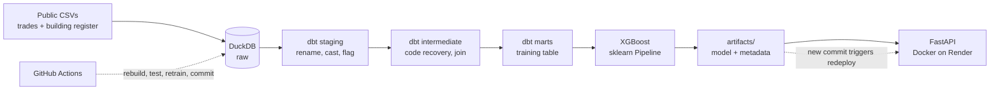

# Seoul Apartment Price Prediction (2026 rebuild)

An end-to-end rebuild of my 2022 MSc thesis model: raw public data is loaded into **DuckDB**, cleaned and tested with **dbt**, used to train an **XGBoost** model that is evaluated honestly on a time split, served through a **FastAPI** endpoint in **Docker** on **Render**, and retrained by **GitHub Actions**.

**Live API:** https://seoul-apt-api.onrender.com/docs
*(Free hosting: the first request after 15 idle minutes can take up to a minute while the service wakes up.)*


---

## Why this project

In 2022 my thesis model reported **R² 0.947** for Seoul apartment prices. Re-reading that code, I found the number was inflated: rows were split at random, so the same apartment complex appeared in both training and test sets, and missing values were filled after sorting by the target. The thesis pipeline was also seven notebooks run by hand, with intermediate CSVs and no tests.

This repository rebuilds it as a reproducible pipeline and measures how much of the original score was real.

## Key result

Same data, same model, same features. Only the way the test set is chosen changes.

| Evaluation | R² | MAE (10k KRW / m²) | MAPE |
|---|---:|---:|---:|
| Baseline: global median | -0.056 | 672 | 40.8% |
| Baseline: district median | 0.474 | 466 | 25.3% |
| A. Random split (thesis method) | 0.930 | 166 | 10.0% |
| B. Group split (whole complexes held out) | 0.820 | 270 | 16.2% |
| **D. Time split (train ≤ 2025, test 2026)** | **0.831** | **292** | **15.6%** |

- The random split reproduces the thesis-level score (0.93). Holding out whole complexes drops it to 0.82: about **0.1 of R² came from memorising individual buildings.**
- The reported score is the **time split**, which matches how the model is used: learn from the past, price the future.
- In plain terms, the model is off by about **2.9 million KRW per m²** on average (≈15.6%), against 4.7 million for a district-median rule.

Two changes I expected to help were tested and **rejected** because they made the time-split score worse:

| Experiment (time split) | R² | MAE | MAPE |
|---|---:|---:|---:|
| D. Final model | **0.831** | **292** | **15.6%** |
| E. + log-transformed target | 0.812 | 303 | 15.8% |
| F. + neighbourhood (dong) code | 0.802 | 310 | 16.1% |
| G. F without certification grades | 0.800 | 312 | 16.1% |

Removing energy and green-building certification changed R² by only 0.002. That does not mean certification has no effect on price; it means that once location, age and size are known, it adds little extra *predictive* information. Estimating its causal effect would need a different design.

## Architecture



## Pipeline

**1. Load (`src/load_raw.py`)**
CSVs are loaded into a DuckDB `raw` schema with every column as text, so codes keep their leading zeros. Loads are idempotent (`CREATE OR REPLACE`) and every row records its source file.

**2. Transform and test (dbt)**

| Layer | What happens |
|---|---|
| `staging` | One model per source: English names, types, flags for cancelled / presale / direct trades |
| `intermediate` | Recover 7,234 missing district codes from names (validated at 99.8% on rows where the code was known); collapse the building register to one row per parcel to prevent join fan-out; join trades to buildings with a reason code for every failed match |
| `marts` | `mart_training_trades`: one row per usable trade, deterministic features only |

The training funnel is fully counted:

```
Apartment trades           198,179
  matched to a building    167,630   (84.6%)
  not cancelled            158,546
  not a presale right      158,327
  not a direct deal        153,884   (77.6% of all trades)
```

25 dbt tests run before any model is trained (`not_null`, `unique`, `accepted_values`, and a custom test that price and area are positive). Diagnostic queries that informed each decision are kept in `analyses/` with their result and decision written at the top.

**3. Train and evaluate (`src/train_baseline.py`)**
Everything fitted on data (imputation, encoding) sits inside one scikit-learn `Pipeline`, so it is learned from the training period only. Missing certification grades are encoded as a `none` category, because an uncertified building is a real state, not a missing measurement. After evaluation, the final model is refit on all data and saved with a metadata file (training time, data cutoff, features, held-out metrics).

**4. Serve (`app/main.py`)**
FastAPI with a typed request schema: invalid input is rejected with a 422 before reaching the model. The feature list is read from the model metadata, and the server refuses to start if the schema and the model disagree.

**5. Deploy (`Dockerfile`)**
A slim image with serving-only dependencies pinned to the training versions. Render builds it from the repository, health-checks `/health`, and keeps the previous version live if a new one fails.

**6. Retrain (`.github/workflows/retrain.yml`)**
Downloads a raw-data snapshot from a GitHub Release, rebuilds the warehouse, runs `dbt build`, retrains, and commits the new model, which triggers a redeploy. A failing data test stops the job, so a bad month of data cannot reach production.

## Try the API

```bash
curl -X POST https://seoul-apt-api.onrender.com/predict \
  -H "Content-Type: application/json" \
  -d '{
        "district_name": "강서구",
        "floor_area_m2": 84.96,
        "floor": 1,
        "building_age": 32,
        "households": 488
      }'
```

Only `district_name`, `floor_area_m2`, `floor` and `building_age` are required; other building details are optional and imputed as in training.

| Endpoint | Returns |
|---|---|
| `POST /predict` | Predicted price per m² and estimated total price (10k KRW), plus the model's training time and test MAE |
| `GET /model-info` | Training time, data cutoff, feature list and held-out metrics |
| `GET /health` | Liveness check used by the host |

## What changed from the 2022 thesis

| Area | 2022 thesis | 2026 rebuild |
|---|---|---|
| Storage | A new CSV saved after every step | One DuckDB file with raw → staging → intermediate → marts |
| Process | Seven notebooks run in order by hand | SQL models rebuilt with one `dbt build` |
| Data checks | Visual inspection | 25 automated tests before training |
| Join duplicates | `drop_duplicates(keep='last')` after the join | Register collapsed to one row per parcel first, `unique` test proves it |
| Missing values | Forward-filled after sorting by price (leaks the target) | Fitted inside the pipeline on training rows only |
| Split | Random rows | Time-based, with group split as a check |
| Metrics | RMSE on a standardised target (not interpretable) | R², MAE in KRW per m², MAPE, against naive baselines |
| Public assessed price | Same-year value used as a feature (not yet published at trade time) | Excluded; a point-in-time join is future work |
| Delivery | Notebook output | Live API, containerised, retrained by CI |

## Limitations

- **Scope:** small single-building apartments without a multi-family register record are excluded (they behave like a different market segment and their building attributes are unknown).
- **Data window:** trades reported in 2024–2026; the most recent month is incomplete because trades can be reported up to 30 days after the contract.
- **Missing features:** coordinates are missing for 8.3% of training rows and elevator counts for 96.4%. Only about 13% of trades have an energy or green-building grade.
- **Retraining** currently uses a fixed raw-data snapshot; automatic monthly collection from the public API is in progress.

## Next steps

- Fetch new months from the public transactions API (key stored in GitHub Secrets) and run the workflow on a monthly schedule
- Let XGBoost handle missing numerics natively instead of median imputation; drop the near-empty elevator feature
- Hyperparameter tuning with `TimeSeriesSplit`
- Prediction intervals and SHAP explanations in the API response
- Point-in-time join for the public assessed price

## Repository layout

```
.github/workflows/retrain.yml   CI retraining job
analyses/                       diagnostic SQL (a01–a12), each with result and decision
app/main.py                     FastAPI service
artifacts/                      trained model + metadata (committed, 1.8 MB)
docs/data_sources.md            where the raw files come from
models/                         dbt models: staging / intermediate / marts
src/load_raw.py                 CSV → DuckDB raw schema
src/train_baseline.py           time-split training, baselines, final model
src/ablation_split.py           random vs group vs time split
src/experiments.py              feature and target experiments
src/sample_request.py           builds a real request from the test set
tests/                          custom dbt test
Dockerfile, requirements-api.txt   serving image
requirements.txt                training environment
```

## Run locally

```bash
python -m venv .venv && source .venv/bin/activate   # Windows: .venv\Scripts\Activate.ps1
pip install -r requirements.txt

# Put the raw CSVs in data/raw/ (see docs/data_sources.md)
python src/load_raw.py
dbt build --profiles-dir .
python src/train_baseline.py

uvicorn app.main:app --reload     # http://127.0.0.1:8000/docs
```

Or run the serving container:

```bash
docker build -t seoul-apt-api .
docker run --rm -p 8000:8000 seoul-apt-api
```

## Data

Apartment sale transactions and the building register (recap title section) for Seoul, published by the Ministry of Land, Infrastructure and Transport through the Korean public data portal (data.go.kr) and the Building HUB. Raw files are not stored in the repository; see `docs/data_sources.md`.

---

Chunjin Kim · rebuilt in November 2026 from an MSc thesis written in 2022
